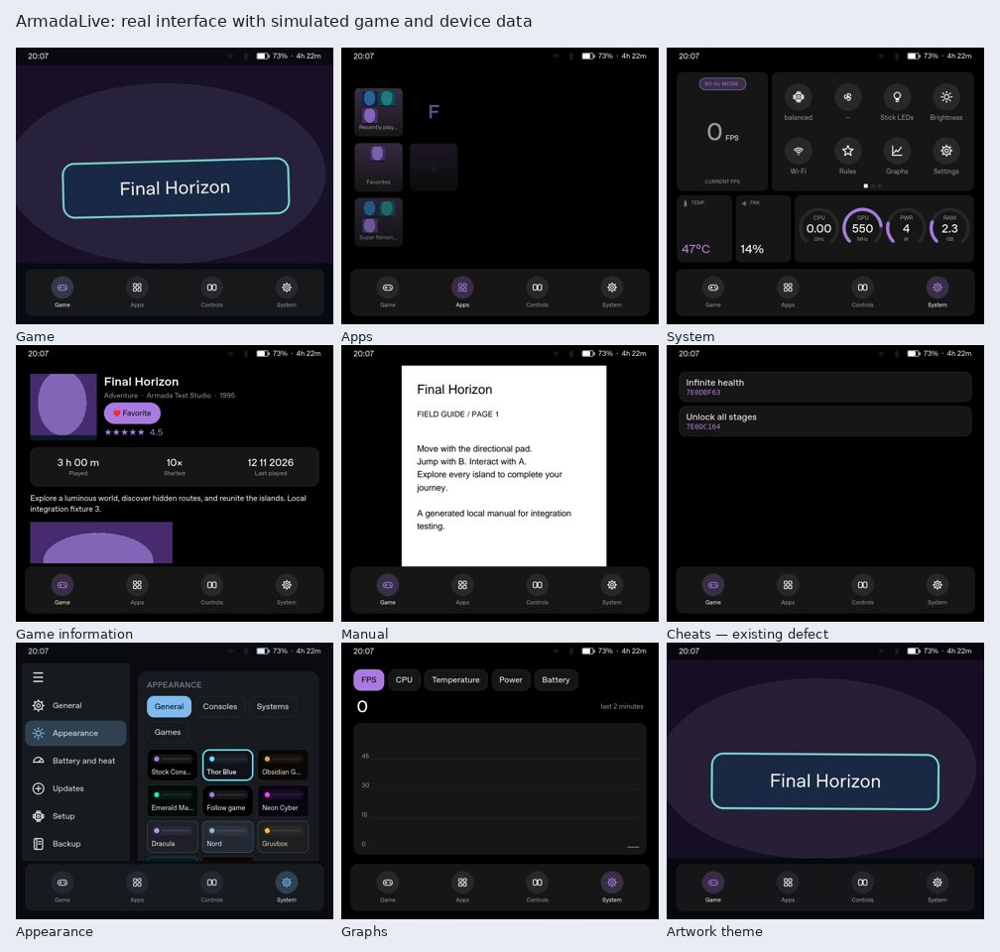

# Integrated validation results

The combined six performance changes were exercised locally on 2026-11-15 using
the real application, Qt 6.12.0 software rendering, generated game data, and
isolated external-service fixtures. Docker is unavailable in the authoring
workspace; the accompanying Docker recipe has not been built or run.

## Results

| Check | Result |
| --- | --- |
| Complete Python suite | 281 tests completed: 275 passed, two failures, four errors |
| Real graphical application | All 13 routes loaded their intended page; 163 of 164 assertions passed |
| Screenshots | 21 captures, including three window sizes |
| Slow or failed subprocesses | Four integration tests passed with real command fixtures and production timeouts |
| Both persistence writers together | Two integration tests passed with real files and background workers |
| Docker execution | Unavailable; image remains unbuilt and unrun |

The validation command returns failure. It does not hide the remaining failures.
The six Python failures are the existing display-session tests that cannot create
Unix sockets in this workspace. The graphical failure is an existing Cheats-page
defect in files unchanged by the six performance changes.

## Interface and worker coverage

- Real clicks navigate from game artwork to Info, Apps, System and Settings, and
  select a theme. Each of the 13 routes is checked against its actual loaded page,
  so a fallback to the home page cannot count as coverage.
- Real catalog readers consume generated game lists, artwork, manuals, cheats,
  saved application layouts and play history.
- Rapid selections converge on the latest metadata. Hidden Info avoids new reads
  and catches up on resume.
- Both the native manual viewer and the image fallback load generated manuals.
  The fallback renders three pages, pauses while blanked, and resumes the current
  selection. Artwork requests are asynchronous and bounded.
- Exactly seven presentation pollers switch to their configured slower intervals
  when blanked, hidden or minimized. Two essential system pollers continue.
  Each 1.2-second observation recorded zero presentation reads and respectively
  two, four and two essential reads. This is an observation window, not a claim
  that hidden polling stops indefinitely.
- Logo animation pauses and resumes with presentation activity. Layouts render at
  620 by 540, 800 by 600, and 1240 by 1080 pixels.
- Executable fixtures exercise actual one-, two- and four-second service timeouts,
  malformed replies, nonzero exits, recovery, serialized commands, discarded stale
  reads and latest-value coalescing. Event-loop heartbeat gaps stay below the
  test's 0.5-second ceiling; hung subprocesses are reaped.
- Backup export waits for both application and history writers. Restore prevents
  older queued writes from overwriting restored files. A failed restart resumes
  both writers and their deferred edits.

## Defects and remaining failures

### Corrected test lifetime defect

A discovery mock retained a bound callback to an object with an active Qt timer.
Later garbage collection on a worker thread destroyed that object on the wrong
thread and crashed the suite. The unchanged test reproduced the crash three times;
clearing the mock during owner-thread cleanup passed three identical reproductions.
The complete suite then finished without the crash or wrong-thread timer warnings.

This test-only correction is included in [pull request 11](https://github.com/FabianZettl/armadalive/pull/11)
at [commit d42013a](https://github.com/brendannoble/armadalive/commit/d42013a952b56d4ef9932e91b534255b4058a48f).

### Existing Cheats-page defect

`Cheats.qml:27` calls `cheats.is_active`, but that Python method is not exposed as a
Qt slot. Two populated cheat rows produce the same callable-method error. A real
click updates the backend and disposable configuration, while the selected border
stays at width one instead of two. The harness records that failed assertion and
returns a nonzero status. `armadalive/cheats.py` and `armadalive/qml/Cheats.qml` are
identical to upstream base `8012ca9156de0bd71877751c18521d4c36b86ff5`; no unrelated
Cheats change is bundled into the performance branches.

### Socket-dependent tests blocked by this workspace

All are in `tests.test_run_sh.RunSh`:

- `test_desktop_mode_shows_a_window_in_the_desktops_session`
- `test_game_mode_still_starting_fails_so_the_unit_retries_instead_of_ending_quietly`
- `test_on_the_x11_side_the_app_is_ended_when_the_plasma_session_shows_up_so_the_unit_restarts_it`
- `test_the_bottom_session_is_used_as_it_is`
- `test_a_session_that_appears_while_waiting_is_taken`
- `test_at_boot_the_plasma_session_is_waited_for_before_the_x11_side_is_used`

Existing resource warnings about unclosed files remain visible in the test log.

## Reproduce

Follow [the container instructions](container-validation.md). The same runner was
executed locally with the installed dependencies:

```sh
ARMADALIVE_VALIDATION_PYTHON=python bash scripts/validate-container.sh ./new-report-directory
```

It saves both phase logs, dependency versions, the graphical assertion report,
screenshots, and an aggregate status. Generated fixtures and process commands are
isolated. External service success, graphics acceleration, physical input, panel
power behavior and battery savings remain outside this software-rendered check.


